<div align="center">

<a href="https://crimsonreporthub.com" title="Open the live site"></a>
<br><sub>Today's front page, captured live</sub>

# Crimson Desert Report Hub

**The independent Crimson Desert newspaper.**<br>
Original reports, the official patch record and what players are seeing, with every source in view.

[**Read the paper**](https://crimsonreporthub.com/) · [Patch record](https://crimsonreporthub.com/patches) · [Issue Board](https://crimsonreporthub.com/issues) · [Observatory](https://crimsonreporthub.com/observatory) · [Catch Up](https://crimsonreporthub.com/catch-up)

<p align="center">
  <a href="https://crimsonreporthub.com" title="Open the live site">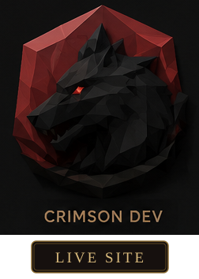</a>&nbsp;
  <a href="https://crimsonreporthub.com/issues" title="Open the public Issue Board">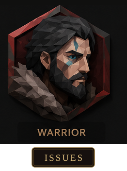</a>&nbsp;
  <a href="CONTRIBUTING.md" title="Contribute to the project">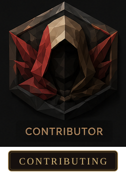</a>&nbsp;
  <a href="https://github.com/Statusnone420/Crimson-Desert-Report-Hub/wiki" title="Read the wiki">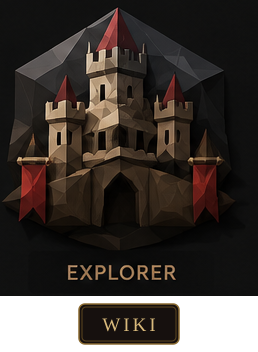</a>&nbsp;
  <a href="SECURITY.md" title="Security policy">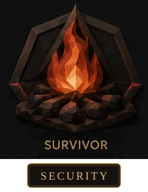</a>&nbsp;
  <a href="https://github.com/Statusnone420/Crimson-Desert-Report-Hub/stargazers" title="Star the repository">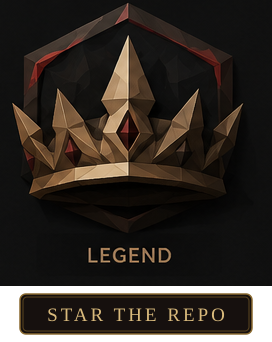</a>
  <br>
  <a href="docs/README.md" title="Browse the documentation">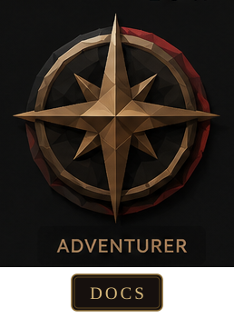</a>&nbsp;
  <a href="https://github.com/Statusnone420/Crimson-Desert-Report-Hub/actions/workflows/ci.yml" title="Continuous integration">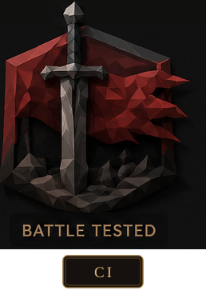</a>&nbsp;
  <a href="https://github.com/Statusnone420/Crimson-Desert-Report-Hub/pulls" title="Pull requests">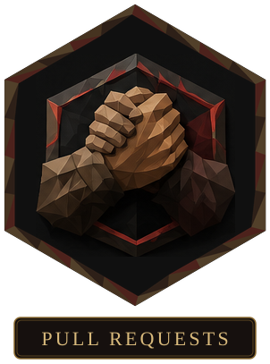</a>&nbsp;
  <a href="docs/PRIVACY.md" title="Privacy model">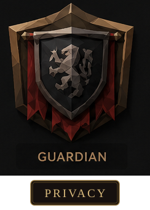</a>&nbsp;
  <a href="https://github.com/Statusnone420/Crimson-Desert-Report-Hub/discussions" title="Community discussions">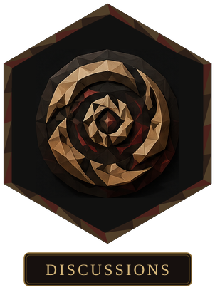</a>&nbsp;
  <a href="#license-and-credit" title="GNU AGPL v3 with an attribution notice">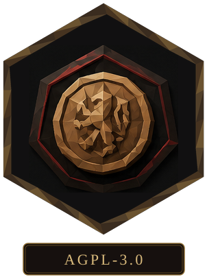</a>
</p>

<sub>Unofficial and fan-run · Not affiliated with Pearl Abyss</sub>

</div>

---

## Read it before you play

Crimson Desert Report Hub is a newspaper for one game. It puts the developer's own words, the press, and the players side by side, and it never pretends they are the same thing.

| On the desk | What you get |
| --- | --- |
| **[News](https://crimsonreporthub.com/news)** | Original Hub reports, each with its sources, plus selected press and creator coverage that links back to the publisher. |
| **[Patch record](https://crimsonreporthub.com/patches)** | Every retained official patch, an automatic rundown of its stated fixes, and an [archive](https://crimsonreporthub.com/patches#archive) where each version keeps its own claim record. |
| **[Issue Board](https://crimsonreporthub.com/issues)** | Anonymous check-ins: **Happening to me**, **Not happening for me**, and, after an official fix, **Fixed for me** or **Still happening**. Each exact patch, hotfixes included, starts a fresh tally. |
| **[Observatory](https://crimsonreporthub.com/observatory)** | Steam review mood, players online, Twitch audience and source radar, each labelled as context, never as proof. |
| **[Catch Up](https://crimsonreporthub.com/catch-up)** | Away for a while? Pick the last patch you played and read everything that changed since. |
| **[Watch](https://crimsonreporthub.com/watch)** | Official video and selected creator coverage, linked to the original channels. |
| **Feeds** | Original articles and patch rundowns through [Atom](https://crimsonreporthub.com/feed.xml) or [RSS](https://crimsonreporthub.com/rss.xml). |

## Built for honest answers

- **Separate registers.** Official claims, player check-ins, source-radar links and editorial coverage each keep their own label. A link is a lead, not evidence; a developer's fix claim is not proof that a problem is gone.
- **Silence is not "fixed".** No reports means no reports. Empty boards say so instead of inventing activity.
- **Nothing to track.** No player accounts, ads or analytics trackers. Check-ins and private problem reports use Cloudflare Turnstile, and the database stores salted one-way network hashes, never raw IP addresses.
- **Private by default.** Raw submissions, rejected scanner candidates and private problem reports never reach public pages, feeds or exports.

Read the [privacy model](docs/PRIVACY.md) and the [architecture](docs/ARCHITECTURE.md) for the details.

## How it works

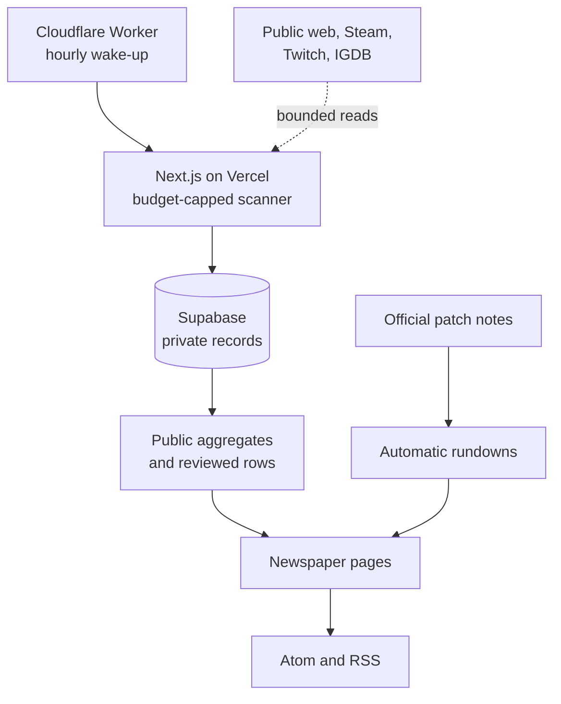

A protected trigger wakes the app on a schedule. The scanner respects its pause, interval and spending limits, gathers public context through approved lanes, and updates private review queues and public aggregates. AI calls are budget-capped and fail closed. Official patch notes become rundowns from stored fix excerpts, with no extra model call.

**Stack:** Next.js (App Router) and TypeScript on Vercel · Supabase Postgres with row-level security · Cloudflare Workers and Turnstile · OpenRouter for capped AI triage · Tavily for bounded web discovery · Vitest and Playwright.

## Run it locally

Use the Node.js version in `.node-version`, then:

```bash
npm ci
npm run preview:seed
npm run dev:preview
```

Open `http://127.0.0.1:3130`. The preview uses invented data and never writes to a hosted database. To run against your own Supabase project, copy `.env.local.example` to `.env.local`, fill it in, and run `npm run dev`.

GitHub checks every pull request with lint, unit tests, type checks, a production build, the desktop, mobile and operator browser suites, and every database migration with its tests on a throwaway database. A pull request that changes only documentation skips the browser suites, and also the database tests unless it touches `supabase/`. To run the same checks except the database tests on your own machine, stage your changes and run:

```bash
npm run verify
```

[Contributing](CONTRIBUTING.md) has the details.

| Path | What lives there |
| --- | --- |
| `src/app` | Routes, pages, feeds and API handlers |
| `src/components` | The newspaper and the operator console |
| `src/lib` | Data access, the scanner and its automation |
| `supabase/migrations` | The full schema history |
| `cloudflare/scanner-cron` | The hourly wake-up Worker |
| `tests` | Vitest unit tests and Playwright browser tests |

## Join in

<p>
  <a href="docs/ARCHITECTURE.md" title="Architecture">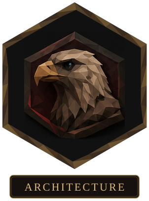</a>&nbsp;
  <a href="https://github.com/Statusnone420/Crimson-Desert-Report-Hub/wiki/Data-Sources-and-Automation" title="Data sources and automation">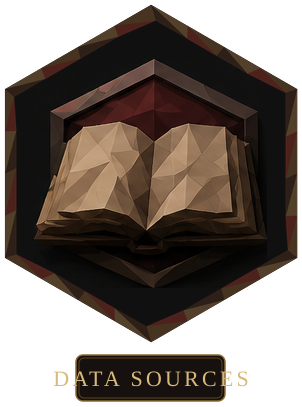</a>&nbsp;
  <a href="#made-with-ai" title="Made with AI">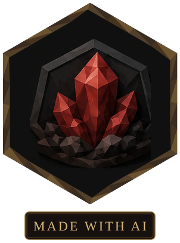</a>
</p>

| You want to... | Go here |
| --- | --- |
| Tell us about a problem on a page, privately | The **Report a problem** button on the site. No account needed. |
| Report a website bug in public | [Open an issue](https://github.com/Statusnone420/Crimson-Desert-Report-Hub/issues/new/choose) |
| Ask a question or pitch an idea | [Discussions](https://github.com/Statusnone420/Crimson-Desert-Report-Hub/discussions) |
| Learn how the Hub works | [The wiki](https://github.com/Statusnone420/Crimson-Desert-Report-Hub/wiki) |
| Send code | [Contributing](CONTRIBUTING.md), then a pull request |
| Report a security problem | [Security policy](SECURITY.md) |
| Get game or account support | [Pearl Abyss support](https://support.pearlabyss.com/) |

GitHub posts are public. Keep passwords, account details and personal information out of them.

## Made with AI

This project is proudly built by one person working with AI coding assistants. The AI writes and reviews a lot of the code. Every change still has to pass the same gate before it ships: tests, type checks, a production build, browser tests, and a review.

## License and credit

The code is free software under the [GNU Affero General Public License v3.0](LICENSE), with additional terms in [NOTICE](NOTICE). In short:

- Use it, study it, change it, run your own copy.
- If you share it or run it as a website, publish your source under the same license.
- Keep the credit: **Based on Crimson Desert Report Hub by Statusnone**, with a link to this repository, in your site's footer or About page.

Crimson Desert and its images belong to Pearl Abyss and are not covered by this license. Crimson Desert Report Hub is an independent fan project and is not affiliated with or endorsed by Pearl Abyss.

<div align="center">
<br>
<sub>Crimson Desert Report Hub · made by Statusnone</sub>
</div>
